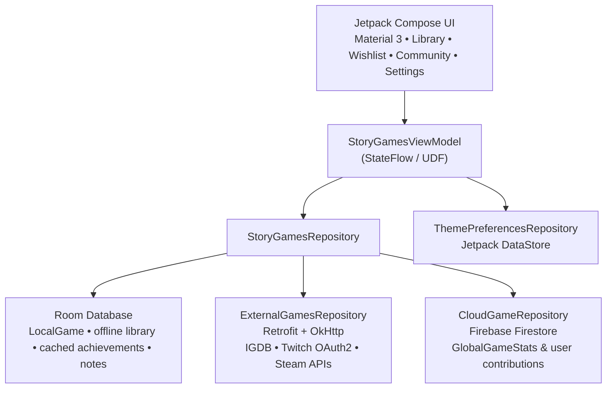

<div align="center">


# Story Games Tracker & Community Hub

**Track your single-player & narrative games, 100% Platinum runs, spoiler-protected Steam achievements, and live community rankings.**

[-3DDC84?style=for-the-badge&logo=android&logoColor=white)](https://developer.android.com)
[](https://kotlinlang.org)
[-4285F4?style=for-the-badge&logo=jetpackcompose&logoColor=white)](https://developer.android.com/jetpack/compose)
[](#architecture--tech-stack)
[](.github/workflows/build-apk.yml)
[](https://firebase.google.com)

<br />


</div>

---

## Overview

Story Games Tracker & Community Hub is a modern Android app for players who love narrative games, completionist runs, and Steam-driven game tracking. It blends local-first persistence with cloud sync so your library, notes, ratings, wishlist, achievements, and community stats remain available across sessions.

The project is built around a hybrid repository pattern: Room stores the local library and cached game state, Retrofit + OkHttp call Steam, IGDB, and Twitch services, and Firestore handles global community ranking data and user contributions.

---

## Key Features

### 1. Personal Library & Steam Auto-Sync
- Zero-bloat local database powered by Room SQLite with `LocalGame` entries for owned games and wishlist items.
- Automatic Steam library and wishlist import using a linked SteamID64 or vanity profile name.
- IGDB API v4 + Steam store search for game discovery and metadata enrichment.
- Steam price tracking with historical/discount information and optional price alerts.
- “100% Platinum” indicators with premium glow styling for completionist runs.

### 2. Steam Achievements with Spoiler Protection
- View unlocked vs. missing achievements with a progress summary like `X / Y unlocked • Z%`.
- Filter by All, Unlocked, or Missing achievement states.
- Hidden or story-critical achievements are masked behind a Steam-style spoiler guard until unlocked.
- Achievement data is cached locally for offline browsing.

### 3. Community Ranking & Flexible Auth Modes
- Google Sign-In mode for cloud-backed profiles, ratings, recommendations, and real-time global rankings.
- Steam-only mode for users who want to use Steam login or SteamID-based access without a Google account.
- Offline mode with full local storage for library, notes, cached achievements, and personal progress.
- Community leaderboard data is stored in Firestore under `global_game_stats` and synced with each user’s contributions.

### 4. Dynamic Theme Engine & Personalization
- Seven built-in visual themes: Cyberpunk Neon, Dark Fantasy, Sci-Fi Space, Retro Synthwave, Nordic Valhalla, Wasteland Pip-Tech, and Samurai Sakura.
- Custom theme designer with editable primary, secondary, background, and surface colors.
- User preference storage via Jetpack DataStore.
- Multi-language support: German, English, Spanish, and French.

### 5. Game Discovery, Notes, and Inventory
- Search for games with IGDB and Steam fallback strategies.
- Track personal notes, play status, ratings, and recommendation flags.
- Inventory-style Steam integration screen for additional Steam-specific views.
- Rich local metadata including playtime, genres, release year, and cover art.

---

## Architecture & Tech Stack

The project follows MVVM with a hybrid repository architecture and a single source of truth for data.



### Tech Stack Summary
- UI Layer: Jetpack Compose, Material 3, custom typography, edge-to-edge layout, `AsyncImage`, navigation.
- State & Concurrency: Kotlin Coroutines, `StateFlow`, `collectAsStateWithLifecycle`, ViewModel.
- Local Persistence: AndroidX Room + DataStore Preferences.
- Networking: Retrofit 2, OkHttp 4, Moshi JSON, IGDB Apicalypse, Twitch OAuth2 bearer token handling, Steam API access.
- Cloud & Security: Firebase Authentication, Firestore, Google Sign-In, Credential Manager, zero-trust Firestore security rules.
- Build: Gradle, KSP, Secrets Gradle Plugin, GitHub Actions APK automation.

---

## Security & Zero-APK-Secrets Design

This repository is designed to be safe for public hosting and APK distribution.

- No active API keys are stored in source code, `BuildConfig`, or the checked-in `.env.example` file.
- Runtime secrets are loaded from a protected Firestore vault at `/admin_vault/api_secrets`.
- Access is restricted via Firestore security rules to the verified admin user (`nico.schaefer.hn@gmail.com`).
- Public fallback paths are included for game discovery, Steam library/wishlist imports, and achievement data when external API access is unavailable.
- The app uses `AppConfig` to keep public endpoints and private runtime credentials separate.

Key runtime configuration values defined in `AppConfig` include:
- `TWITCH_AUTH_BASE_URL = "https://id.twitch.tv/"`
- `IGDB_BASE_URL = "https://api.igdb.com/v4/"`
- `STEAM_API_BASE_URL = "https://api.steampowered.com/"`
- `STEAM_STORE_BASE_URL = "https://store.steampowered.com/api/"`
- `STEAM_OPENID_PROVIDER_URL = "https://steamcommunity.com/openid/login"`
- `LOCAL_DATABASE_NAME = "story_games_tracker.db"`
- `DATASTORE_PREFERENCES_NAME = "story_games_user_prefs"`

---

## Project Structure

```text
├── .github/
│   └── workflows/
│       └── build-apk.yml              # GitHub Actions APK build pipeline
├── app/
│   ├── build.gradle.kts               # App module configuration
│   ├── src/
│   │   ├── androidTest/
│   │   ├── main/
│   │   │   ├── AndroidManifest.xml
│   │   │   ├── java/com/example/
│   │   │   │   ├── config/
│   │   │   │   │   └── AppConfig.kt   # API endpoints and runtime secrets
│   │   │   │   ├── data/
│   │   │   │   │   ├── cloud/          # Firestore models and CloudGameRepository
│   │   │   │   │   ├── local/          # Room entities and DAOs
│   │   │   │   │   ├── preferences/    # DataStore theme + language + Steam pinning
│   │   │   │   │   ├── remote/         # IGDB / Twitch / Steam services and models
│   │   │   │   │   └── repository/     # StoryGamesRepository
│   │   │   │   ├── ui/
│   │   │   │   │   ├── auth/           # Google Sign-In, Steam, offline gate flows
│   │   │   │   │   ├── components/     # Game cards, dialogs, search sheet
│   │   │   │   │   ├── i18n/           # App strings and localized labels
│   │   │   │   │   ├── screens/        # Library, Wishlist, Community, Settings, Inventory
│   │   │   │   │   ├── theme/          # Theme definitions and color palettes
│   │   │   │   │   └── viewmodel/      # ViewModels
│   │   │   │   ├── MainActivity.kt     # App shell and bottom navigation
│   │   │   │   └── ...
│   │   │   └── res/
│   │   │       └── drawable/          # App icon and banner assets
│   └── proguard-rules.pro
├── .env.example                       # Secret template / no live keys
├── build.gradle.kts                   # Top-level Gradle config
├── firebase.json                      # Firebase configuration stub
├── firebase-blueprint.json            # Cloud schema blueprint
├── firestore.rules                    # Firestore security rules
├── firestore.test.js                  # Firestore validation tests
├── gradle.properties                  # Gradle properties
├── gradlew                            # Root wrapper (if present in your local checkout)
├── gradlew.bat                        # Windows wrapper (if present in your local checkout)
├── settings.gradle.kts                # Root project setup
├── README.md                          # Project documentation
└── metadata.json
```

---

## Tech Details & App Behavior

### Auth & Sessions
The app supports:
- Google Firebase Auth
- Steam OpenID login flow
- SteamID-based local sessions without a Google account
- Offline local mode when no account is available

The root app session logic is centralized in `MainActivity`, which checks the active Firebase user or a previously stored Steam-linked ID and decides whether the app is allowed to open the main tracker hub.

### Theme & Language Preferences
Theme preferences are handled in `ThemePreferencesRepository` using DataStore. Supported styles include:
- `cyberpunk_neon`
- `dark_fantasy`
- `sci_fi_space`
- `retro_synthwave`
- `nordic_valhalla`
- `wasteland_piptech`
- `samurai_sakura`
- `custom_design`

Localization supports:
- `de` — German
- `en` — English
- `es` — Spanish
- `fr` — French

### Data Model Highlights
- `LocalGame` stores library metadata, personal notes, play state, reviews, price information, cached achievements, and completion status.
- `GlobalGameStats` aggregates community-wide ratings, recommendations, and 100% clears.
- `UserGameContribution` backs per-user cloud sync and delta updates.
- `AdminApiSecrets` holds the runtime admin-only credentials for Twitch/IGDB/Steam access.

---

## Firebase & Cloud Setup

The repo includes:
- `firebase.json` for Firebase config metadata
- `firebase-blueprint.json` for schema blueprint guidance
- `firestore.rules` for zero-trust access rules
- `firestore.test.js` for rule validation/tests

The intended cloud model includes:
- `global_game_stats` for community rankings
- `users/{uid}/game_contributions/{gameId}` for user-specific backup and sync data
- `admin_vault/api_secrets` for protected admin credentials

---

## Build Information

The app is configured with:
- `applicationId = "com.aistudio.storygames.vkrpzt"`
- `minSdk = 24`
- `targetSdk = 36`
- `compileSdk = 36`
- `Java compatibility = 11`
- `buildConfig = true`

The project uses the Secrets Gradle Plugin with `.env` and `.env.example` to keep secret management consistent with web apps.

---

## License

Distributed for personal and community use. All game titles, covers, achievement icons, and related media remain the property of their respective publishers and platforms (IGDB, Steam, and others).

---

## Summary

Story Games Tracker & Community Hub is a production-style Android app for narrative-game fans who want a clean, local-first, community-powered tracker for their library, wishlist, Steam progress, and story-driven completion goals.
