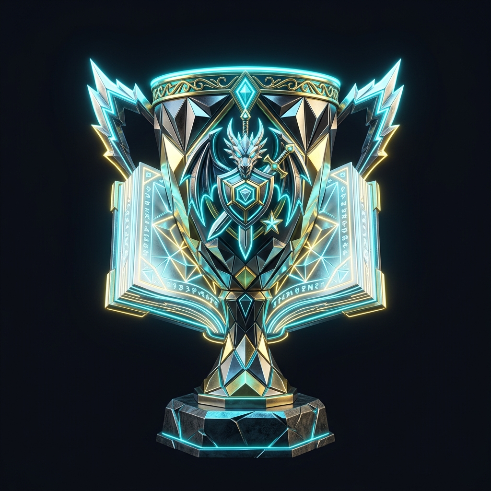
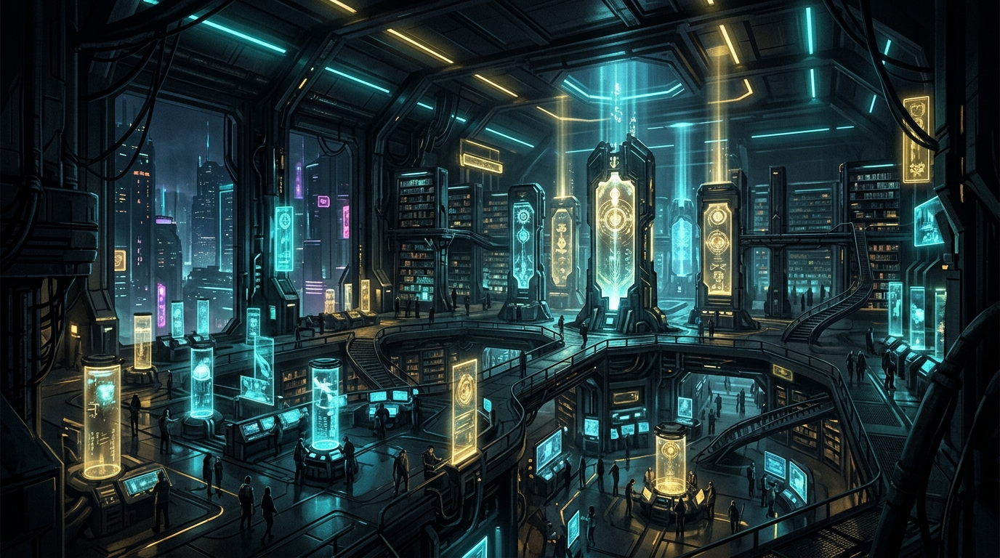
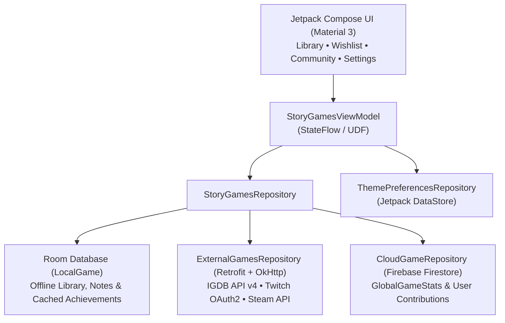

<div align="center">



#  Story Games Tracker & Community Hub

**Track your single-player & narrative games, 100% Platinum runs, spoiler-protected Steam achievements, and live community rankings.**

[-3DDC84?style=for-the-badge&logo=android&logoColor=white)](https://developer.android.com)
[](https://kotlinlang.org)
[-4285F4?style=for-the-badge&logo=jetpackcompose&logoColor=white)](https://developer.android.com/jetpack/compose)
[](#architecture--tech-stack)
[](.github/workflows/build-apk.yml)

<br />



</div>

---

##  Overview

**Story Games Tracker & Community Hub** is a modern Android application built with **Kotlin** and **Jetpack Compose** for players who love story-driven video games and completionist runs.

Whether you want to automatically sync your **Steam Library & Wishlist**, track **unlocked vs. missing Steam Achievements** with built-in **story spoiler protection**, highlight your **100% Platinum completions** with an animated gold/platinum glow, or contribute ratings to a **real-time global Community Ranking**, Story Games Tracker supports both **Cloud-Connected** and **100% Offline** workflows.

---

##  Key Features

###  1. Personal Game Library & Steam Auto-Sync
- **Zero-Bloat Local Database**: Starts completely clean using **Room SQLite** (`LocalGame`) with full offline persistence.
- **Automatic Steam Library & Wishlist Import**: Link your 64-bit SteamID or vanity profile name once to automatically import your owned games (including playtime hours) and wishlist.
- **IGDB API v4 & Steam Store Search**: Search for any narrative title using IGDB's **Apicalypse** query engine (with in-memory Twitch OAuth2 bearer token caching) and seamless Steam Store fallback.
- **100% Platinum Run Glow**: Games marked with `is100Percent = true` are highlighted across your library with a custom animated **Platinum/Gold border and shimmer effect**.

###  2. Steam Achievements with Story Spoiler Protection
- **Unlocked vs. Missing Progress**: Click any game in your library to view your achievement progress bar (`X / Y unlocked • Z%`) and filter by **All**, **Unlocked (`✓`)**, or **Missing (`🔒`)**.
- **Steam-Style Spoiler Guard**: Hidden or story-critical achievements that you haven't unlocked yet are automatically masked behind a **Spoiler Shield** (*"Hidden Achievement (Spoiler) – Tap to reveal"*). Simply tap an individual card to reveal its title and description, or toggle global spoiler masking for all remaining locked achievements.
- **Offline Achievement Cache**: Once loaded, achievement lists are serialized and cached inside Room so you can inspect your completion checklist anytime offline.

###  3. Global Community Ranking & Flexible Auth Modes
- **Three Flexible Modes**:
  1. **Google Sign-In Mode (Cloud & Community)**: Unlocks 5-star ratings, *"Would you recommend it?"* votes, and real-time synchronization with the global **Community Ranking** (`GlobalGameStats`).
  2. **Steam-Only Mode**: Sign in with your SteamID64, profile name, or OpenID without requiring a Google account. Enjoy automatic library, wishlist, and achievement syncing plus local notes and 100% run tracking.
  3. **Offline Mode**: Use the app completely offline with local Room storage for your library, cached achievements, completion status, and personal playthrough notes.

###  4. Dynamic Theme Engine (DataStore Preferences)
Switch themes instantaneously in **Settings** (persisted via Jetpack DataStore):
| Theme | Palette | Vibe |
| :--- | :--- | :--- |
| **Cyberpunk Neon** | Cyber Yellow • Electric Cyan • Neon Magenta | High-contrast futuristic night city |
| **Dark Fantasy** | Obsidian Grey • Crimson Blood Red • Rune Gold | Gothic RPG & dark narrative atmosphere |
| **Sci-Fi Space** | Deep Void Blue • Starlight White • Ice Cyan | Clean deep-space telemetry |

---

##  Architecture & Tech Stack

The project follows **MVVM (Model-View-ViewModel)** with a single-source-of-truth **Hybrid Repository** pattern combining local Room persistence, remote Retrofit services, and real-time Cloud Firestore synchronization.



### Tech Stack Summary
- **UI Layer**: Jetpack Compose, Material Design 3, Coil (`AsyncImage`), Edge-to-Edge WindowInsets, Custom Typography (`Orbitron`, `Plus Jakarta Sans`, `JetBrains Mono`).
- **State & Concurrency**: Kotlin Coroutines, `StateFlow`, `collectAsStateWithLifecycle`, ViewModel.
- **Local Persistence**: AndroidX Room (`2.7.0` with KSP) + AndroidX DataStore Preferences.
- **Networking**: Retrofit 2, OkHttp 4, Moshi JSON, IGDB Apicalypse plain-text POST queries, Twitch OAuth2 token caching.
- **Cloud & Security**: Firebase Authentication (Jetpack `CredentialManager` + Web OAuth fallback), Cloud Firestore real-time snapshots, Zero-Trust Firestore Security Rules.

---

##  Security & Zero-APK-Secrets Design

This repository is designed to be **100% safe for public open-source hosting and APK distribution**:
- **No Hardcoded API Keys**: Neither the source code, `BuildConfig`, nor `.env.example` contains any active API keys or client secrets.
- **Zero-Trust Cloud Vault**: Optional API credentials (such as Twitch/IGDB or Steam Web API keys) are managed exclusively at runtime via a server-protected Firestore vault (`/admin_vault/api_secrets`) guarded by strict Firestore Security Rules, and held only in volatile memory (`@Volatile` RAM) during an authorized session.
- **Public Fallbacks Included**: Even without external API keys, game search, public Steam library/wishlist imports, and achievement lookups automatically fall back to public Steam Store & Community endpoints.

---

##  Getting Started & Building the APK

### Option 1: Download Ready-to-Install APK (GitHub Actions)
Every push to the repository automatically triggers the [**.github/workflows/build-apk.yml**](.github/workflows/build-apk.yml) pipeline:
1. Open the **Actions** tab in your GitHub repository.
2. Select the latest **Build Android APK** workflow run.
3. Scroll down to **Artifacts** and download **`StoryGamesTracker-APK`**.

### Option 2: Build Locally via Gradle
1. Clone this repository:
   ```bash
   git clone https://github.com/<your-username>/<your-repo-name>.git
   cd <your-repo-name>
   ```
2. Build the Debug APK:
   ```bash
   gradle assembleDebug
   ```
3. The compiled APK will be generated at:
   ```text
   app/build/outputs/apk/debug/app-debug.apk
   ```

---

##  Project Structure

```text
├── .github/workflows/
│   └── build-apk.yml                # Automated GitHub Actions APK build pipeline
├── app/src/main/java/com/example/
│   ├── config/
│   │   └── AppConfig.kt             # Central endpoints & volatile runtime config
│   ├── data/
│   │   ├── cloud/                   # Firebase Firestore models & CloudGameRepository
│   │   ├── local/                   # Room Entity (LocalGame), GameDao & AppDatabase
│   │   ├── preferences/             # DataStore ThemePreferencesRepository
│   │   ├── remote/                  # IGDB v4, Twitch OAuth2 & Steam API/Achievements
│   │   └── repository/              # Hybrid StoryGamesRepository
│   ├── ui/
│   │   ├── auth/                    # Google Sign-In, Steam Login & Offline mode gate
│   │   ├── components/              # GameListCard (100% Glow), GameDetailDialog (Achievements & Spoiler Guard)
│   │   ├── screens/                 # LibraryScreen, WishlistScreen, CommunityRankingScreen, SettingsScreen
│   │   ├── theme/                   # Cyberpunk Neon, Dark Fantasy & Sci-Fi Space themes
│   │   └── viewmodel/               # StoryGamesViewModel
│   └── MainActivity.kt              # Root navigation & session management
├── firestore.rules                  # Zero-trust Firestore security rules
└── firebase-blueprint.json          # Cloud schema blueprint
```

---

## 📄 License

Distributed for personal and community use. All game titles, covers, and achievement icons are property of their respective publishers and platforms (IGDB / Steam).
